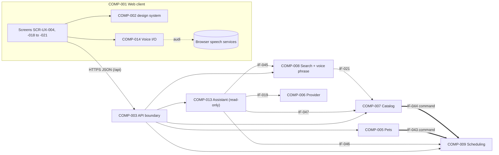

# Software Architecture — Iteration 2 Delta (VetCare v2)

> **Delta document.** `ARCHITECTURE_V3.md` remains in force: style (modular monolith), stack (React + Vite client, Node.js + Express API, PostgreSQL on Neon, Vercel), components COMP-001 to COMP-012, interfaces IF-001 to IF-032, ADR-001 to ADR-018 and constraints CR-001 to CR-026 apply unless this document changes them. New IDs continue the sequences: COMP-013+, IF-033+, CTR-010+, ADR-019+, CR-027+, P05-ASM-020+, P05-RISK-021+.
> **Contract files:** `API_SPEC_V2.yaml` (v2.0.0) supersedes `API_SPEC_V1.yaml`; it contains all of 1.0 unchanged plus IF-033 to IF-042. The schema change is migration `002` (§8.2), which extends `DATA_MODEL_V1.md`.

## 1. Document Metadata

| Field | Value |
|---|---|
| Stage | P05 — Software Architecture |
| Version | 4.0 (delta over 3.0) |
| Sprint | `SPRINT-002` (the single current sprint; P03 PRIOR-005) |
| Status | **READY_WITH_ASSUMPTIONS** |
| Generated | 2026-11-09 (deadline 2026-11-10, TD-34) |

### 1.1 Inputs Reviewed

`REQUIREMENTS_V4.md` v4.1 (+ validation), `PRIORITIZATION_V3.md` v3.1 (+ validation), `UX_SPEC_V3.md` v3.1 (+ `UX_SPEC_VALIDATION_V3.md`, PASS_WITH_WARNINGS, READY_WITH_CONDITIONS), `ARCHITECTURE_V3.md`, `API_SPEC_V1.yaml`, `DATA_MODEL_V1.md`, `migrations/001_initial_schema.sql`, the current code (`src/modules/*`, `src/shared/*`, `client/src/*`, `tests/contract-consistency.test.js`, `tests/helpers.js`) and team decisions TD-21 to TD-34.

### 1.2 Summary of the Delta

- **Voice runs in the browser.** Speech-to-text and text-to-speech use the browser's Web Speech API (TD-22) in a new client component, COMP-014. Only text reaches the server.
- **Voice search interpretation runs on the server** (COMP-008, new operation `voiceSearch`), so the rules BR-043, BR-044 and BR-053 are covered by the existing Node test runner (P03-RISK-011) and are applied before results are shown (P04-ASM-030).
- **New backend module COMP-013 Assistant**: read-only, stateless, rule-based (TD-21). It classifies the question, queries other modules through read interfaces and composes the Spanish answer from the UX templates (ADR-019).
- **Pets, catalog and scheduling are extended** with add/edit/remove pet, update/remove offering, and cancel/reschedule appointment. Removal is logical (`removed_at`, migration 002; ADR-020), as V3 CR-018 already required.
- **One new outcome code**, APPOINTMENT_NOT_CHANGEABLE (409). No new feature switch (ADR-021).

### 1.3 Status Explanation

READY_WITH_ASSUMPTIONS: every committed story has a component, interface and data decision. Assumptions P05-ASM-020 to -026 (§16) cover browser speech behavior and the keyword lists of the assistant; none blocks implementation.

---

## 2. Architectural Scope

| Stories | Priority (P03) | Architectural element |
|---|---|---|
| US-035 voice search | P0 | COMP-014 (listen) → IF-041 `POST /api/search/voice` (COMP-008) |
| US-036, US-038, US-040, US-041 assistant (conversation, offerings, help, spoken answers) | P0 | COMP-001 SCR-UX-018 + COMP-014 → IF-042 `POST /api/assistant/messages` (COMP-013) |
| US-037, US-039 assistant (providers, my appointments) | P1 | COMP-013 intents `providers`, `provider_hours`, `provider_contact`, `my_appointments` |
| US-004 to US-007 pets | P1 | COMP-005: IF-009 (extended), IF-033 to IF-035 |
| US-022, US-023, US-025, US-026 appointment cancel/reschedule | P2 | COMP-009: IF-038 to IF-040 |
| US-011, US-012, US-014, US-015 offering update/remove | P2 | COMP-007: IF-036, IF-037 |
| US-042 read aloud | Conditional | COMP-014 `speak` only (client) |
| US-027 to US-033 ordering | Deferred | Unchanged; COMP-012 and its switches stay as built (off) |

**Not covered:** server-side speech processing, LLMs or any external AI service (P01-OOS-012); storing transcripts or conversations (BR-050); voice for providers (BR-041).

## 3. Architectural Drivers (new)

| Driver | Source | Architectural response |
|---|---|---|
| Speech-to-text and text-to-speech required, no budget | CR-027; TD-21, TD-22 | Browser Web Speech API; no external service, no key (ADR-022). |
| Same result as typing | BR-042 | Voice search and assistant offering answers call the **same** search query function as `GET /api/search`. |
| Testable voice rules | P03-RISK-011; FR-041 | Phrase interpretation and intent rules are pure server functions, tested with `node --test`. |
| Typed fallback everywhere | NFR-006; TD-26 | Feature detection in COMP-014; the server never depends on voice. |
| Nothing stored | NFR-007; BR-050 | Stateless endpoints; transcripts and questions are not logged (CR-027). |
| Read-only assistant | BR-045 | COMP-013 has no write access and no command interface (CR-028). |
| Logical removal with cascaded cancellation | BR-034, BR-035; CR-018 | `removed_at` + one command to COMP-009 in the same transaction (ADR-020). |
| One working day | TD-34 | Minimal new structure; reuse of slots, booking lock, search query, design system. |

## 4. System Context (changes)

| New element | Kind | Notes |
|---|---|---|
| Browser speech services | External, outside the system boundary | Chrome's speech recognition sends audio to the browser vendor's service (P01-ASSUMPTION-028, accepted under TD-11). VetCare code never receives audio. Speech synthesis is local or vendor-provided, depending on the voice. |
| Microphone permission | Browser | Requires HTTPS (production is HTTPS; `localhost` is allowed for development). |

Trust boundary unchanged: the transcript is untrusted client input like any other text (CR-003).

## 5. Architectural Style

Unchanged (ADR-002 modular monolith). COMP-013 is a new backend module; COMP-014 is a client-side library inside COMP-001's workspace.

---

## 6. Component Architecture (delta)

### 6.1 Inventory changes

| ID | Component | Change |
|---|---|---|
| COMP-001 | Web Client Application | New screens SCR-UX-018 to -021; modified SCR-UX-004, -005, -007, -008, -011, -012, -013; owner tabs *Buscar · Asistente · Mis citas · Mis mascotas*. |
| COMP-002 | UI Design System Library | New components COMP-UX-023 to -027; modified COMP-UX-006, -007, -008, -011, -022. No new token. |
| COMP-005 | Pets | Add, edit, logical removal; list returns all pet fields and excludes removed pets. |
| COMP-007 | Catalog | Update service/product; logical removal; every query excludes removed offerings; new read query "providers with an active home service". |
| COMP-008 | Search and Discovery | Search query extracted as a reusable function; new `voiceSearch` operation with the phrase interpreter. |
| COMP-009 | Scheduling | Cancel and reschedule for both parties; reschedule context; commands to cancel upcoming appointments of a pet or a service; read query "upcoming appointments of an owner". Booking rejects removed pets and services. |
| **COMP-013** | **Assistant** (new, backend, read-only) | Classifies a question, gathers data through read interfaces, composes the answer (§6.2). |
| **COMP-014** | **Voice I/O** (new, client library) | Feature detection, listen once (es-CO), speak / stop, voice-reply preference (§6.3). |

### 6.2 COMP-013 — Assistant

| Aspect | Specification |
|---|---|
| Location | `src/modules/assistant/` registered in `src/modules/index.js` like the other modules: `normalize.js`, `intents.js`, `answers.js`, `assistant.js` (router). |
| Interface | IF-042 `POST /api/assistant/messages` (owner only, CR-001). Request `{ text (1–200), viaVoice? }`; response `AssistantAnswer` (API_SPEC_V2). |
| State | None. Each request is answered alone (BR-050). |
| Dependencies (read-only) | COMP-008 IF-045 (phrase interpretation + search function); COMP-006 IF-019 (provider list, profile, weekly hours); COMP-007 IF-047 (providers with an active home service); COMP-009 IF-046 (owner's upcoming appointments). No table of its own; no writes (CR-028). |
| Normalization | Lowercase; remove accents (á→a … ü→u, ñ kept); replace punctuation (`¿?¡!.,;:`) with spaces; collapse spaces. The original text is kept for quoting. |
| Classification | First matching rule wins (P05-ASM-022 keyword lists, Spanish, on normalized text): |
| 1. `action_request` | Verbs of action on data: `agend`, `reserv`, `cancel`, `reprogram`, `cambia(r) (mi) cita`, `pedir`, `compr`. Link `search` for `agend`/`reserv`/`pedir`/`compr`; `owner_appointments` for `cancel`/`reprogram`/`cambia`. (BR-045, AC-129) |
| 2. `help` | `ayuda`, `que puedo (preguntar|hacer)`, `que sabes`, `como funciona`. (AC-145) |
| 3. `my_appointments` | `mi cita`, `mis citas`, `proxima cita`, `cuando es mi`, `tengo cita`. (AC-141 to AC-144) |
| 4. provider detail | A provider name is found in the question (BR-052: every active provider whose normalized public name is contained in the question, or whose name tokens of 3+ letters, excluding `clinica`, `veterinaria`, `veterinario`, `vet`, all appear in it). With hour words (`horario`, `hora`, `abre`, `atiende`, `cierra`) → `provider_hours`; with contact words (`direccion`, `donde`, `queda`, `telefono`, `contacto`, `correo`, `llamar`) → `provider_contact`; several providers → `several_matches`; a detail word but no provider → `no_match`. |
| 5. `providers` | Provider words (`veterinari`, `clinica`, `proveedor`) with a list word (`hay`, `cuales`, `que`, `disponible`, `lista`). Type: `clinica(s)` → clinics; `independiente(s)` → independents; `domicilio`/`casa` → providers with an active service whose modality is `home` or `both` (BR-054). |
| 6. `offerings` | Offering words (`quien ofrece`, `donde (hay|venden|ofrecen)`, `cuanto (cuesta|vale)`, `precio`, `valor`, `servicio`, `producto`, `hay`) and a non-empty remainder: the text after removing these words and question words (`quien`, `que`, `cual(es)`, `cuanto`, `donde`, `hay`, `ofrece(n)`, `cuesta(n)`, `vale(n)`, `precio`, `valor`, `de`, `del`, `el`, `la`, `los`, `las`, `un`, `una`) is passed to the **same phrase interpreter as voice search** (IF-045: BR-043 species, BR-044 fillers) and then to the search function, including the BR-053 retry. Empty remainder → `fallback`. |
| 7. `fallback` | Everything else, including medical questions (BR-046, AC-147). |
| Composition | `answers.js` turns each intent and its data into `text`, `items` (max 5; order BR-047: providers by name, offerings by price then name, appointments nearest first), `total`, `searchLink` (offerings with total > 5) and `linkTo`, using **exactly** the Spanish templates of UX_SPEC_V3 SCR-UX-018 v3.1 (ADR-019). Formatting: prices `$ 45.000` (es-CO); hours `8:00 a. m.`; dates in Bogotá (ADR-008); weekdays Monday first. The greeting is rendered by the client (it needs no data). |
| Errors | Validation of `text` (VALIDATION_FAILED); any query failure → UNEXPECTED. No question is ever rejected for content: unknown → `fallback`. |

### 6.3 COMP-014 — Voice I/O (client)

| Aspect | Specification |
|---|---|
| Location | `client/src/voice/speech.js` (+ a small React hook `useVoice.js`). Used by COMP-UX-023, -026, -027. Built once (P03 DEP-025, DEP-026). |
| Detection | `recognitionSupported = 'SpeechRecognition' in window || 'webkitSpeechRecognition' in window`; `synthesisSupported = 'speechSynthesis' in window`. Unsupported → components not rendered (NFR-006). |
| `listenOnce()` | One recognition session: `lang = 'es-CO'`, `interimResults = false`, `continuous = false`, `maxAlternatives = 1`. Resolves `{ transcript }` on result; rejects with `not_allowed` (permission denied → MSG-VOICE-DENIED), `no_speech` / `aborted` / other (→ MSG-VOICE-NOHEAR). A `stop()` ends listening (COMP-UX-023 "detener"). Only one session at a time. |
| `speak(text)` | Cancels any current utterance, then speaks `text` with `lang = 'es-CO'`, choosing a voice whose `lang` is `es-CO`, else any `es-*`, else the default (P05-ASM-021). Exposes `speaking` state for *"Leyendo…"* / *"Detener lectura"*. `stopSpeaking()` cancels. Screens call `stopSpeaking()` on unmount (leaving the screen). |
| Preference | `voiceReplies` stored in `localStorage` key `vetcare.voiceReplies` (`on` default; BR-049). Device only; never sent to the server. |
| Privacy | Transcripts are sent only to IF-041/IF-042 and are kept in React state only for the current screen (BR-050). |

### 6.4 Changes to existing backend modules

| Module | Change (implementation notes) |
|---|---|
| COMP-005 Pets (`src/modules/pets/owner-pet.js`) | `GET /owner/pets` returns `OwnPet` (all fields) for pets with `removed_at IS NULL`. `POST /owner/pets` validates with the existing sign-up pet validator (same rules, BR-037). `PUT /owner/pets/:petId` replaces the fields. `DELETE /owner/pets/:petId`: in one transaction, `SELECT … FOR UPDATE` the own active pet → set `removed_at = now()` → IF-043 cancel its upcoming appointments → return `RemovalResult`. Another owner's or a removed pet → NOT_FOUND. |
| COMP-007 Catalog (`src/modules/catalog/offerings.js`) | `PUT /provider/services/:offeringId` and `PUT /provider/products/:offeringId` reuse the publish validators (independent veterinarians home only, BR-007) and update own active offerings of that kind. `DELETE /provider/offerings/:offeringId`: in one transaction, take the provider lock (IF-024), set `removed_at`, and for a service call IF-044. All catalog, profile, search and booking reads add `removed_at IS NULL`. New read IF-047. |
| COMP-008 Search (`src/modules/search/offerings.js`) | Extract the existing SQL into `searchOfferings(db, { q, species })` (unchanged results plus `removed_at IS NULL`). New `voice-phrase.js` with `interpretPhrase(transcript) → { query, querySpeciesKept, species }` implementing BR-043/BR-044 (the stripped species expression is reinserted in its original position for `querySpeciesKept`). `POST /search/voice`: interpret → empty `query` → `outcome: empty_query` (no search) → else search `query` with the species (detected, or the request filter if none, AC-119; both named → `all`) → if no results and species words were removed → search `querySpeciesKept` (BR-053, `retried: true`). Text limits as `GET /search` (120 characters after interpretation). |
| COMP-009 Scheduling (`booking.js`, `slots.js`) | **Cancel** (`POST /owner|provider/appointments/:id/cancel`): own appointment; `UPDATE … SET status='cancelled', cancelled_at=now() WHERE id=$1 AND status='scheduled' AND starts_at > now()`; 0 rows → APPOINTMENT_NOT_CHANGEABLE (or NOT_FOUND if not own). **Reschedule context**: reuse the slot computation of the booking context for the appointment's service and provider, removing `currentStartsAt`. **Reschedule**: one transaction with the provider lock (IF-024) → re-check the appointment is own, scheduled and not started → check the new start is offered (same function as booking, BR-018) → `UPDATE starts_at`. The independent-vet unique index guards concurrency (CR-008); a unique violation → SLOT_UNAVAILABLE. **Booking** additionally rejects removed pets (NOT_FOUND) and removed services (NOT_FOUND), reading the pet `FOR SHARE` (§8.3). New commands IF-043, IF-044 and read IF-046. |
| COMP-003 API Boundary | Registers the new routes; owner-only guard for IF-041, IF-042 (providers → NOT_FOUND, CR-006/BR-041); same-origin rule unchanged for the new POST/PUT/DELETE. |
| COMP-010 Shared Kernel | `OUTCOME_CODES` + APPOINTMENT_NOT_CHANGEABLE → 409 (`src/shared/outcomes.js`). Accent-folding helper may move here (pure text, no business rule). |

### 6.5 Component diagram (delta)



---

## 7. Interfaces and Interaction Rules (delta)

### 7.1 Client–backend interfaces (all in `API_SPEC_V2.yaml`)

| ID | Operation(s) | Role | Outcomes | Stories / AC |
|---|---|---|---|---|
| IF-009 (ext.) | `listOwnPets` → `OwnPet[]` (active pets) | Owner | — | US-005; AC-016 to AC-018 |
| IF-033 | `addOwnPet` | Owner | VALIDATION_FAILED | US-004; AC-014, AC-015, AC-078 |
| IF-034 | `updateOwnPet` | Owner, own pet | VALIDATION_FAILED; NOT_FOUND | US-006; AC-019, AC-020 |
| IF-035 | `removeOwnPet` → `RemovalResult` | Owner, own pet | NOT_FOUND | US-007; AC-021, AC-022, AC-079 |
| IF-036 | `updateService`, `updateProduct` | Provider, own offering | VALIDATION_FAILED (incl. NOT_ALLOWED); NOT_FOUND | US-011, US-014; AC-030, AC-031, AC-035, AC-036 |
| IF-037 | `removeOffering` → `RemovalResult` | Provider, own offering | NOT_FOUND | US-012, US-015; AC-032, AC-037, AC-083 |
| IF-038 | `cancelOwnerAppointment`, `cancelProviderAppointment` | Owner / provider, own | APPOINTMENT_NOT_CHANGEABLE; NOT_FOUND | US-022, US-025; AC-057 to AC-059, AC-065, AC-066 |
| IF-039 | `getOwnerRescheduleContext`, `getProviderRescheduleContext` | Owner / provider, own | APPOINTMENT_NOT_CHANGEABLE; NOT_FOUND | US-023, US-026; AC-061 |
| IF-040 | `rescheduleOwnerAppointment`, `rescheduleProviderAppointment` | Owner / provider, own | SLOT_UNAVAILABLE; APPOINTMENT_NOT_CHANGEABLE; VALIDATION_FAILED; NOT_FOUND | US-023, US-026; AC-060, AC-062, AC-067, AC-068 |
| IF-041 | `voiceSearch` | Owner | VALIDATION_FAILED | US-035; AC-115, AC-117, AC-119, AC-120, AC-159 |
| IF-042 | `askAssistant` | Owner | VALIDATION_FAILED | US-036 to US-040; AC-125 to AC-148, AC-160 |

### 7.2 Internal interfaces (new)

| ID | Provider → consumer | Kind | Purpose | Rules |
|---|---|---|---|---|
| IF-043 | COMP-009 → COMP-005 | **Command** | Cancel the upcoming scheduled appointments of a pet | Caller's transaction; only `scheduled` with `starts_at > now` (BR-034); returns the count |
| IF-044 | COMP-009 → COMP-007 | **Command** | Cancel the upcoming scheduled appointments of a service | Caller's transaction, under the provider lock; same rules |
| IF-045 | COMP-008 → COMP-013 | Read | `interpretPhrase` and `searchOfferings` (with BR-053 retry helper) | Pure / read-only |
| IF-046 | COMP-009 → COMP-013 | Read | Owner's upcoming scheduled appointments with service, provider, pet, start; nearest first; total | Own data only (BR-048, NFR-002) |
| IF-047 | COMP-007 → COMP-013 | Read | IDs of providers with at least one active service whose modality is `home` or `both` | Excludes removed offerings |

### 7.3 Dependency rules (changes to V3 §7.3)

- **Commands** allowed now: the three of V3 plus **COMP-005 → COMP-009 (IF-043)** inside pet removal and **COMP-007 → COMP-009 (IF-044)** inside service removal. Each operation still contains at most one command (V3 rule).
- **Read-only queries** added: COMP-013 → COMP-006 (IF-019), COMP-007 (IF-047), COMP-008 (IF-045), COMP-009 (IF-046).
- **Prohibited:** COMP-013 calling any command or writing any table (CR-028); any module other than COMP-008 implementing phrase interpretation (one implementation, BR-042).

### 7.4 Error contract

Adds **APPOINTMENT_NOT_CHANGEABLE → 409**: client shows *"Esta cita ya no se puede cancelar."* / *"…reprogramar."* (UX_SPEC_V3 SCR-UX-007/-008/-021). Everything else as V3 §7.4.

---

## 8. Conceptual Data Architecture (delta)

### 8.1 Data concept changes

| Concept | Change |
|---|---|
| Pet | Gains a removal mark. Active pets: `removed_at IS NULL`. Removed pets keep their row so appointments still show the name (CR-018). |
| Offering | Gains a removal mark. Removed offerings disappear from catalog, profile, search, booking and the assistant, but stay referenced by appointments and orders. |
| Appointment | No new column. Cancel uses the existing `status`/`cancelled_at`; reschedule updates `starts_at` (the appointment keeps its identity). Who cancelled is not recorded (no requirement asks for it). |
| Voice transcript, assistant question | Not stored anywhere (BR-050). |

### 8.2 Migration `002_iteration2_removal.sql` (to be added in P06 under `migrations/`)

```sql
ALTER TABLE pet      ADD COLUMN removed_at timestamptz;
ALTER TABLE offering ADD COLUMN removed_at timestamptz;
CREATE INDEX pet_owner_active_idx      ON pet (owner_id)            WHERE removed_at IS NULL;
CREATE INDEX offering_provider_active_idx ON offering (provider_id, kind) WHERE removed_at IS NULL;
```

Additive and backward compatible with the deployed code (existing queries keep working until they add the filter). Applied with the existing migrator (`npm run migrate`, `DATABASE_URL_UNPOOLED`, CR-024). Rollback: not needed for additive columns (V3 §17 limitation on down steps unchanged).

### 8.3 Integrity-critical sequences

**Reschedule (IF-040).**

```text
BEGIN
  lock provider row (IF-024)                      -- same lock as booking and hours save (CR-009)
  read appointment: own, status scheduled, starts_at > now   -- else APPOINTMENT_NOT_CHANGEABLE / NOT_FOUND
  check new start is offered for the service now (booking slot function, BR-018) and ≠ current start
  UPDATE appointment SET starts_at = new WHERE id = … AND status = 'scheduled'
  (independent vet: unique index violation → SLOT_UNAVAILABLE)
COMMIT
```

**Remove a service (IF-037).** `BEGIN` → provider lock → own active service `FOR UPDATE` → `removed_at = now()` → IF-044 cancel upcoming → `COMMIT`. Booking takes the same provider lock and re-reads the service as active, so a booking cannot slip in after the removal.

**Remove a pet (IF-035).** `BEGIN` → own active pet `FOR UPDATE` → `removed_at = now()` → IF-043 → `COMMIT`. **Required change:** booking must read the pet with `removed_at IS NULL … FOR SHARE` inside its transaction (today `owner-pet.js` reads it without a lock), so removal and booking serialize.

### 8.4 Data rules added

- Every read of pets and offerings for users filters `removed_at IS NULL` (CR-029). Appointment and order views do **not** filter (history keeps names).
- Editing a pet or an offering never changes existing appointments (P04-ASM-035, -036).

---

## 9. Security and Quality Architecture (delta)

| Concern | Control |
|---|---|
| Authorization | All new operations derive the user from the session; ownership checked in SQL (`owner_id`/`provider_id` = session). Other users' resources → NOT_FOUND (CR-006). Assistant and voice search are owner-only (BR-041). |
| Same-origin | New POST/PUT/DELETE follow CR-021 (Origin + JSON content type); DELETE without body needs only Origin. |
| Privacy | Transcripts and questions are not logged (CR-027): the request logger records method, path, status and duration only (current behavior); no body logging may be added. |
| Input limits | `text` ≤ 200, `transcript` ≤ 300 characters (API_SPEC_V2). |
| Abuse | No rate limit (unchanged V3 posture; demonstration only, P05-RISK-021). |
| Testability | Pure functions: `interpretPhrase`, `classify`, `composeAnswer` with unit tests on text; database tests for removal, cancel and reschedule with `TEST_DATABASE_URL` (existing pattern). Voice I/O in the browser: manual evidence (P03-RISK-011). |
| Regression | Existing 318 tests must pass; contract tests move to `API_SPEC_V2.yaml` (§15.3). |

---

## 10. UX and Design-System Alignment

| UX element | Architectural support |
|---|---|
| SCR-UX-004 heard line, filled search box and filter (AC-115, AC-117, AC-159) | IF-041 returns `transcript`, `query`, `species`, `retried`, `results`. |
| MSG-VOICE-EMPTY (AC-120) | IF-041 `outcome: empty_query`. |
| MSG-VOICE-NOHEAR / -DENIED | COMP-014 `listenOnce` error kinds (client only). |
| SCR-UX-018 answer table | IF-042 `AssistantAnswer`: `text` = sentence, `items[].label` = row text, `items[].target`, `searchLink`, `linkTo`. Greeting from the client. |
| COMP-UX-026 / -027 | COMP-014 `speak`, `stopSpeaking`, `speaking`, preference. |
| SCR-UX-019/-020 | IF-009 (ext.), IF-033 to IF-035. |
| SCR-UX-021 | IF-039, IF-040. |
| COMP-UX-022 texts with cancelled appointments | `RemovalResult.cancelledAppointments` (optional toast detail). |
| AC-127 conversation not kept | Stateless IF-042; conversation in React state of SCR-UX-018 only. |

The UX contract (UX_SPEC_V2 + V3 v3.1) is preserved; no token or component is redefined here.

---

## 11. Architectural Decision Records (new)

| ID | Title | Status |
|---|---|---|
| ADR-019 | Assistant answers are composed on the server in Spanish | ACCEPTED (TD-19 standing rule) |
| ADR-020 | Logical removal of pets and offerings with cascaded cancellation | ACCEPTED (implements V3 CR-018) |
| ADR-021 | No feature switches for iteration 2 slices | ACCEPTED |
| ADR-022 | Browser Web Speech API for voice input and output | ACCEPTED (TD-22) |

**ADR-019.** *Context:* ADR-011/CR-005 keep user-facing copy out of API responses (errors are codes). The assistant's answers are not errors; they are the product of the rule engine and must be testable against the UX templates (AC-130 to AC-148). *Decision:* COMP-013 returns the final Spanish sentence and row labels; error responses stay code-only. *Consequences:* answer wording changes require a server change; the templates live in one file (`answers.js`); CR-005 is amended by CR-030.

**ADR-020.** *Decision:* pets and offerings get `removed_at`; removal sets it and, for pets and services, cancels upcoming appointments in the same transaction through one command to COMP-009. *Alternatives:* physical delete (breaks appointment history and FKs — rejected by CR-018); a status column (equivalent, but a timestamp also records when). *Consequences:* every user-facing read must filter (CR-029).

**ADR-021.** *Context:* ADR-017 introduced switches so partially built ordering slices stay invisible. *Decision:* iteration 2 uses no new switch; a story that is cut (P03 PRIOR-008) is simply not merged into `dev`/`main`, and each story is merged only when its screen and API are both done. *Consequences:* less configuration in a one-day sprint; `main` must never contain half a story.

**ADR-022.** *Decision:* Web Speech API in the browser (`SpeechRecognition`/`webkitSpeechRecognition`, `speechSynthesis`), `es-CO`. *Alternatives:* cloud speech APIs (cost, keys, server audio handling — rejected by TD-21, TD-22, P01-OOS-012). *Consequences:* works in Chrome desktop and Android (target, NFR-003); other browsers get the typed fallback; recognition needs network and HTTPS; audio goes to the browser vendor (P01-ASSUMPTION-028).

---

## 12. Architectural Risks (new)

| ID | Description | Impact | Likelihood | Mitigation | Status |
|---|---|---|---|---|---|
| P05-RISK-021 | No rate limit on the assistant and voice search | Abuse could load the free database | UNKNOWN | Owner-only, small queries, demo data; accept for the demonstration | OPEN (accepted) |
| P05-RISK-022 | Recognition quality / names | Wrong transcript | Medium | Heard line, editable text, typed path; provider matching on name tokens | OPEN |
| P05-RISK-023 | Browser voice differences (no `es-CO` voice, mobile auto-stop) | Different voice or early stop | Medium | Voice fallback chain (§6.3); `listenOnce` per tap | OPEN |
| P05-RISK-024 | A user-facing read misses the `removed_at` filter | Removed items still bookable or visible | Medium | CR-029; database tests for search, profile, booking after removal | OPEN |
| P05-RISK-025 | Keyword rules misclassify questions | Unhelpful answers | Medium | Fixed order of rules, fallback with examples, unit tests per example phrase of UX_SPEC_V3 | OPEN |
| P05-RISK-026 | Contract tests still point to `API_SPEC_V1.yaml` | False failures or untested contract | High if forgotten | §15.3 step 1 | OPEN |

V3 risks remain as recorded; P05-RISK-017 (half-built slice visible) now applies to iteration 2 stories and is mitigated by ADR-021.

## 13. Constraints and Invariants (new)

| ID | Constraint | Applies to |
|---|---|---|
| CR-027 | Voice transcripts and assistant questions are never stored or logged, on the client (beyond screen state) or on the server. | COMP-001, COMP-003, COMP-008, COMP-013 |
| CR-028 | COMP-013 is read-only: no command interface, no table, no write. | COMP-013 |
| CR-029 | Every user-facing read of pets and offerings excludes removed rows; booking and reschedule reject removed pets and services. History views do not filter. | COMP-005, -007, -008, -009, -013 |
| CR-030 | Amends CR-005: responses carry no user-facing copy **except** `AssistantAnswer.text` and `items[].label` (ADR-019). | COMP-003, COMP-013 |
| CR-031 | Phrase interpretation (BR-043, BR-044, BR-053) has one implementation, in COMP-008, used by IF-041 and IF-045. | COMP-008, COMP-013 |
| CR-032 | Cancel and reschedule act only on own `scheduled` appointments whose start is in the future, with conditional updates. | COMP-009 |

## 14. Traceability Matrix (iteration 2)

| Story | Requirements | Components | Interfaces | Data | Decisions |
|---|---|---|---|---|---|
| US-035 | FR-040–FR-042; NFR-006–NFR-008 | COMP-001, -002, -014, -008 | IF-041 | — | ADR-022; CR-027, CR-031 |
| US-036 | FR-043 | COMP-001, -002, -014, -013 | IF-042 | — | ADR-019, ADR-022; CR-027, CR-028 |
| US-037 | FR-044, FR-048 | COMP-013, -006, -007 | IF-042, IF-019, IF-047 | — | ADR-019 |
| US-038 | FR-045, FR-048 | COMP-013, -008 | IF-042, IF-045 | — | CR-031 |
| US-039 | FR-046, FR-048 | COMP-013, -009 | IF-042, IF-046 | — | — |
| US-040 | FR-047 | COMP-013 | IF-042 | — | — |
| US-041 | FR-049 | COMP-014, -002 | — (client) | localStorage preference | ADR-022 |
| US-042 | FR-050 | COMP-014, -002 | — (client) | — | ADR-022 |
| US-004–US-007 | FR-005–FR-008 | COMP-005, -009 | IF-009, IF-033–IF-035, IF-043 | `pet.removed_at` | ADR-020; CR-029 |
| US-011, US-014 | FR-012, FR-015 | COMP-007 | IF-036 | — | — |
| US-012, US-015 | FR-013, FR-016 | COMP-007, -009 | IF-037, IF-044 | `offering.removed_at` | ADR-020; CR-029 |
| US-022, US-025 | FR-027, FR-030 | COMP-009 | IF-038 | — | CR-032 |
| US-023, US-026 | FR-028, FR-031 | COMP-009, -006 | IF-039, IF-040, IF-024 | — | CR-009, CR-032 |

Every committed and conditional story maps to at least one component and interface; FR-040 to FR-050 and the promoted FRs are covered.

---

## 15. Implementation Guidance and Parallelization

### 15.1 Step 0 (before parallel work, ~30 min, Fonseca + David)

1. Add `migrations/002_iteration2_removal.sql` (§8.2); run locally and on Neon.
2. Point `tests/helpers.js` `API_SPEC_PATH` to `artifacts/05_architecture/API_SPEC_V2.yaml`; update the contract test's expected version to `2.0.0`; add APPOINTMENT_NOT_CHANGEABLE to `src/shared/outcomes.js` (→ 409). Point the QA contract suite (`artifacts/07_qa/test_suites/contract/`) to V2.
3. Add the `removed_at IS NULL` filter to existing reads (search, public profile, own catalog, booking context, booking, owner pets) — CR-029.
4. Extract `searchOfferings(db, { q, species })` in COMP-008 (no behavior change). All tests green.

### 15.2 Parallel tracks (by P03 assignment)

| Track | Who (P03 PROPOSED) | Work | Depends on |
|---|---|---|---|
| A — Voice search | David (server), Jhonier (client) | `voice-phrase.js` + tests; `POST /search/voice`; COMP-014 `listenOnce`; COMP-UX-023 in COMP-006; heard line | Step 0 |
| B — Assistant | Sebas (server + SCR-UX-018), David (offerings intent), Jhonier (COMP-014 `speak`, COMP-UX-026) | `normalize`, `intents`, `answers` + tests per UX example phrase; route; SCR-UX-018 | Track A `interpretPhrase` for offerings (stub until ready) |
| C — Pets | David, Jhonier | IF-009 ext., IF-033–IF-035; SCR-UX-019/-020; owner tab | Step 0 |
| D — Appointments | Casanova, Jhonier/Sebas | IF-038–IF-040; SCR-UX-021; card actions | Step 0 |
| E — Catalog | Casanova, Sebas | IF-036, IF-037; edit mode; card actions | Step 0 |

Order of merging follows P03: A and B (P0) first, then C (P1, with B's P1 intents), then D and E (P2). Each story is merged only when complete (ADR-021).

### 15.3 Shared contracts

`API_SPEC_V2.yaml` (CR-026); UX_SPEC_V3 v3.1 answer templates (single source for `answers.js`); `interpretPhrase` (CR-031); COMP-014 API (§6.3).

### 15.4 Implementation freedoms

Exact regular expressions for the keyword rules (within §6.2 lists); internal file split inside each module; React state management of the conversation; the optional `RemovalResult` detail in toasts.

## 16. Assumptions, Proposals and Required Decisions

| ID | Type | Description | Impact |
|---|---|---|---|
| P05-ASM-020 | ASSUMPTION | Chrome desktop and Android Chrome provide `webkitSpeechRecognition` with `es-CO` and `speechSynthesis` on the HTTPS production domain. | Voice stories; verify in sprint step 1. |
| P05-ASM-021 | ASSUMPTION | If no `es-CO` voice exists, any Spanish voice is acceptable for NFR-008. | Voice quality. |
| P05-ASM-022 | ASSUMPTION | The keyword lists of §6.2 implement P02-ASM-021 ("example phrasings and close variants"); they may be extended without architecture change. | Assistant coverage. |
| P05-ASM-023 | ASSUMPTION | The 120-character search limit applies to the interpreted query; a longer transcript is cut to its first 120 characters after interpretation. | Edge of IF-041. |
| P05-ASM-024 | ASSUMPTION | Rescheduling keeps the appointment ID; no history of previous times is kept (no requirement). | Data model. |
| P05-ASM-025 | ASSUMPTION | The provider lock used by booking is sufficient to serialize reschedule and service removal (same as hours saves, CR-009). | Concurrency. |
| P05-ASM-026 | FACT (verified) | The request logger records no headers, body or query string (`src/http/middleware.js`, CR-020), so CR-027 holds as long as no body logging is added. | CR-027. |

No REQUIRES_DECISION item.

## 17. Limitations and Next Steps

- **Not specified:** UI component code; exact regular expressions; test data content.
- **Next:** P05 validation (quick), then P06 step 0 (§15.1) and track A.
- **Docs to update in P09:** API (V2 operations), DATA_MODEL (migration 002), USER_GUIDE (voice), KNOWN_LIMITATIONS (browser support, vendor speech processing).

## 18. Self-Review

- [x] Every committed and conditional story of SPRINT-002 has components, interfaces and data decisions (§14).
- [x] No unapproved feature; no external service beyond the browser's (TD-22).
- [x] UX contract preserved (§10); no token or component redefined.
- [x] Contracts written: `API_SPEC_V2.yaml` (parsed, all references resolve, 41 unique operations) and migration 002.
- [x] Decisions recorded (ADR-019 to -022) with alternatives; V3 constraints amended explicitly (CR-030).
- [x] Assumptions explicit; no REQUIRES_DECISION.
- [x] Parallel tracks and step 0 defined for a one-day sprint.
